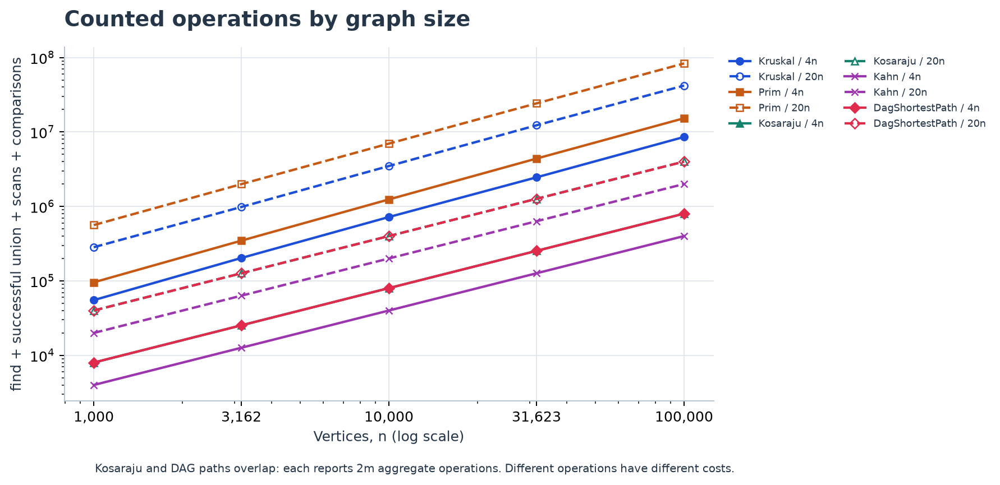
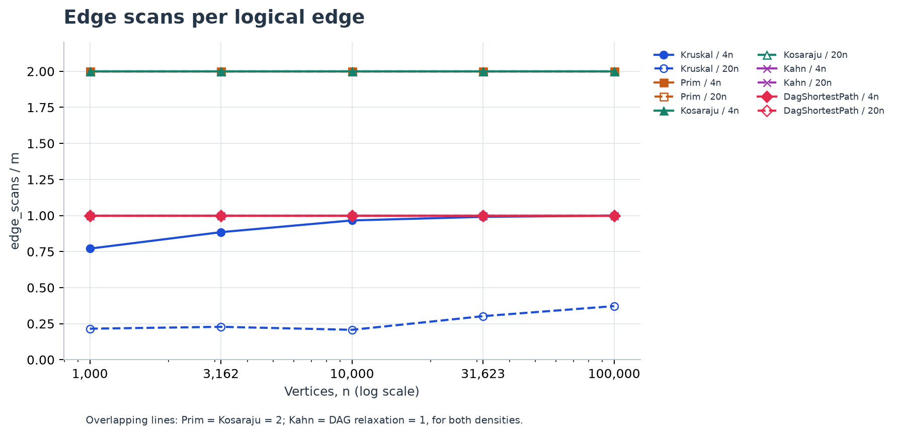
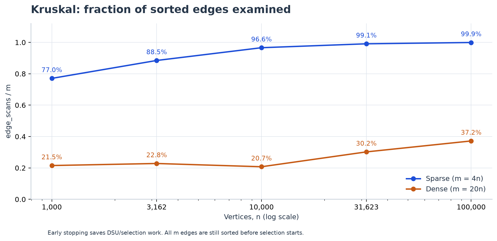

# Assignment 3 - Graphs

**Adilzhan Aliakbar** | Design and Analysis of Algorithms | 18 October 2026

## 1. Design, methods and complexity

The graph stores adjacency lists, a logical edge list and cached indegrees. Each generator call uses a fresh java.util.Random(42). The undirected generator shuffles the vertex permutation, adds its random spanning tree, then adds random non-loop edges. The directed generator uses only random edges. The DAG generator shuffles a rank array and orients each edge from lower rank to higher rank. For a random pair, a is drawn once and b is redrawn until b != a; only then is its weight drawn. All benchmark weights are 1..1000; negative weights are tested separately. Every one of the ten reference triples matched exactly.

| Operation / algorithm | Time | Extra space | Justification |
| --- | --- | --- | --- |
| DSU find / union | O(alpha(V)) amortized | O(1) per call; O(V) DSU | Size linking plus full path compression; makeSet costs O(V). |
| Kruskal forest | O(V + E log(E+1)) | O(V + E) | Merge-sort all edges, then DSU operations on at most E edges. |
| Prim (lazy heap) | O(V + E log(E+1)) | O(V + E) | O(E) candidates enter/leave a heap of up to O(E); scan all vertices. |
| Kosaraju | O(V + E) | O(V + E) | Two iterative DFS passes plus a stored transpose; O(V) frames. |
| Kahn | O(V + E) | O(V) | Copy cached indegrees; each vertex is queued once and each arc scanned once. |
| DAG shortest paths | O(V + E) | O(V) | Kahn plus one topological relaxation pass; distances and parents. |

Counters are incremented inside the algorithms. DSU operations mean find calls plus successful unions. Scans mean traversal/selection examinations: Prim visits both adjacency arcs; Kruskal visits only the sorted selection prefix. Weight comparisons occur in merge sort and PriorityQueue; DAG comparisons compare candidate distances. Kosaraju's transpose construction is timed but excluded from its two-pass scan counter. DAG topological preprocessing is timed but uses separate Kahn counters, so its reported scans count only relaxations. Kahn copies the indegrees maintained when edges are inserted. maxDepth counts live DFS frames, not queue size. Input storage is excluded from the extra-space table; output/working arrays and the transpose are included.

## 2. Correctness, validation and algorithm choice

### Cut-property argument (7 sentences)

Consider a cut that no already-selected forest edge crosses, and choose a minimum-weight edge e crossing it. Take an MST containing the already-selected edges. If e is absent, adding it creates a cycle with another edge f crossing the cut. Since w(e) <= w(f), replacing f by e preserves connectivity and cannot increase the total weight. Thus an MST containing the extended selection exists. Kruskal uses a cut between current DSU components when it accepts the next lightest edge, while Prim uses the cut between its visited set and the remaining vertices. Applying the same argument independently to every connected component proves that both algorithms return a minimum spanning forest, even with ties, negative edges and parallel edges.

### Induction over topological order (8 sentences)

Initialize every indegree-zero vertex to distance zero, equivalently connecting a virtual super-source to all these vertices by zero-weight edges. Every vertex of a finite DAG is reachable from such a source, since repeatedly following predecessors must terminate. Assume that vertices before u in the topological order already have their correct shortest distances. Every path into u ends at a predecessor earlier in the order, so the incoming-edge relaxations have considered every possible last edge using correct predecessor distances. Therefore u's distance is correct before its outgoing edges are relaxed, which proves the induction step. Negative edges do not invalidate the proof because a DAG has no cycles and no later predecessor can improve an already-processed vertex. In a general graph, negative edges require a suitable algorithm such as Bellman-Ford, and a reachable negative cycle makes distances to reachable downstream vertices unbounded below. Saving the predecessor on each strict improvement reconstructs a realizing path whose parent chain terminates at a source.

| Situation | Choice | Reason / qualification |
| --- | --- | --- |
| Undirected, sparse; edge list available | Kruskal | Sorting plus DSU is simple; returns a forest naturally. |
| Undirected; adjacency list available | Prim | Expands a frontier directly from the lists. Lazy heap may hold O(E) edges. |
| Truly dense simple graph, E = Theta(V^2) | Matrix Prim variant | O(V^2) time avoids the heap logarithm; this variant is not implemented. |
| Directed graph; cycles / deadlocks possible | Kosaraju | Groups mutually reachable jobs into SCCs; singleton loops need checking. |
| Dependency order with cycle detection | Kahn | Returns a valid order or explicitly reports a cycle. |
| Directed acyclic graph; negative edges allowed | DAG paths | Topological order allows one pass, from all indegree-zero sources. |
| General weighted directed graph | Dijkstra / Bellman-Ford | Dijkstra for nonnegative weights; Bellman-Ford for negative edges and cycle detection (outside core scope). |

The delivered run passed 15 JUnit 5 tests with zero failures, errors or skips. DSU is checked against set relabeling after random unions; 100 connected random graphs cross-check Kruskal and Prim with n-1 edges and forest invariants; 40 tiny MST cases are also checked by exhaustive edge-subset enumeration. SCC is compared with forward and reverse BFS from every vertex on 40 random graphs with at most 200 vertices. 100 random DAGs with negative weights are compared with Bellman-Ford and have their restored paths checked. File fixtures cover disconnected graphs, a cycle, parallel edges, loops and isolation. A directed path with 100,000 vertices yields 100,000 SCCs and maxDepth=100,000 without recursion; empty graphs, malformed files and long-valued totals are also checked.

## 3. Measured results and normalized counters

| n | m | MST weight | SCC count | DAG distance sum |
| --- | --- | --- | --- | --- |
| 1,000 | 4,000 | 147,970 | 27 | 396,274 |
| 1,000 | 20,000 | 30,363 | 1 | 252,411 |
| 3,162 | 12,648 | 468,911 | 137 | 1,271,911 |
| 3,162 | 63,240 | 97,589 | 1 | 723,157 |
| 10,000 | 40,000 | 1,486,139 | 373 | 3,941,828 |
| 10,000 | 200,000 | 309,550 | 1 | 2,381,342 |
| 31,623 | 126,492 | 4,715,515 | 1,188 | 12,551,891 |
| 31,623 | 632,460 | 968,517 | 1 | 7,376,612 |
| 100,000 | 400,000 | 15,012,094 | 3,923 | 40,096,539 |
| 100,000 | 2,000,000 | 3,056,681 | 1 | 23,512,087 |

| Algorithm | Normalized counter | Sparse range | Dense range |
| --- | --- | --- | --- |
| Kruskal | comparisons / (E log2 E) | 0.896 - 0.949 | 0.922 - 0.953 |
| Kruskal | dsu_ops / E | 2.290 - 2.748 | 0.565 - 0.894 |
| Prim | comparisons / (E log2 E) | 1.831 - 1.946 | 1.826 - 1.892 |
| Kosaraju | scans / (V + E) | 1.600 | 1.905 |
| Kahn | scans / (V + E) | 0.800 | 0.952 |
| DAG paths | scans / (V + E) | 0.800 | 0.952 |

Ranges cover all five sizes at fixed density. The traversal ratios are exactly constant. Sorting/heap comparison ratios stay in a narrow band, consistent with E log E work. Kruskal's DSU/E ratio is bounded but not exactly constant because the stopping prefix varies: with S scans on a connected graph, dsu_ops = 2S + 3(V-1), hence dsu_ops/E <= 2 + 3V/E. Counting DSU calls alone cannot establish the inverse-Ackermann cost; the amortized proof supplies that bound. Observed ratios are evidence consistent with complexity, not an asymptotic proof.

## 4. Scaling curves and slope check

| Counter curve | Sparse slope | Dense slope |
| --- | --- | --- |
| Kruskal scans | 1.055 | 1.119 |
| Prim scans | 1.000 | 1.000 |
| Kosaraju scans | 1.000 | 1.000 |
| Kahn scans | 1.000 | 1.000 |
| DagShortestPath scans | 1.000 | 1.000 |
| Kruskal comparisons | 1.105 | 1.087 |
| Prim comparisons | 1.109 | 1.090 |

OLS fits ln(counter) against ln(n) separately for m=4n and m=20n. Traversal scans have slope 1.000 in both densities. Kruskal scan slopes are 1.055 and 1.119; its sorting-comparison slopes are 1.105 and 1.087. The log factor belongs to sorting, not scans: S <= E. A scan slope above 1 in this finite sample reflects an increasing examined fraction, not an E log E scan bound. Also, both assigned densities are E=Theta(V); 'dense' means a larger fixed constant, not a quadratic density.



Aggregate operations = dsu_ops + edge_scans + comparisons. This is an explicit counting convention, not equal-cost CPU instructions. Kosaraju and DAG paths overlap at 2m.



Prim and Kosaraju equal 2 scans/edge; Kahn and DAG relaxation equal 1. Coincident curves are expected.

## 5. Kruskal prefix, timings and reproducibility



At n=100,000, Kruskal examines 99.92% of sparse edges and 37.18% of dense edges. For n=1,000 these fractions are 77.05% and 21.51%. More alternative connections in the denser sample allow Kruskal to complete the tree after a smaller fraction of the sorted list, while this Prim implementation still scans both arcs of every edge and drains its heap. Sorting all edges remains necessary in Kruskal. The plot therefore explains selection savings, not a universal win for either algorithm.

One warm-up precedes five timed runs; time_ms is their median, including algorithm allocations and preprocessing but excluding graph generation, validation and CSV output. On the delivered run the 100,000-vertex dense case took 901.23 ms for Kruskal and 2610.45 ms for Prim; Kosaraju took 663.88 ms, Kahn 93.07 ms and DAG paths 150.90 ms. Small-graph timings fluctuate and can be nonmonotonic because of JIT compilation, garbage collection, cache effects and background load. Other hardware and JVM versions change these times; operation counts, independent correctness tests and proven bounds are the main evidence.

Environment:

```text
Java: 26.0.2.1+1-7
VM: OpenJDK 64-Bit Server VM
OS: Windows 11 amd64
Processors: 12
Warmups: 1 per algorithm/graph; timed runs: 5; statistic: median
Seed: new Random(42) per graph
```

Run mvn clean verify, then java -Xmx2g -jar target/assignment3-graphs-1.0.jar, then python scripts/analyze.py. The scripts/reproduce.ps1 and scripts/reproduce.sh entry points run all three steps. The CSV contains 50 rows with the exact requested columns. The benchmark fails on a reference mismatch, MST disagreement, invalid topological order, incorrect scan totals or nondeterministic counters. Feature branches and tag v1.0 are preserved in repository.bundle. README documents build instructions and AI assistance. Group and GitHub URL were not supplied and must be completed before submission; no external upload has been performed.

AI-use disclosure: OpenAI Codex generated and locally validated the implementation and report. See README for the full acknowledgement.

Specification source: DAA_Assignment3_Graphs.pdf, supplied assignment, sections 1-10. The detailed ten-case/50-row specification takes precedence over the isolated "four graphs" wording. Optional bonus tasks are not included.
